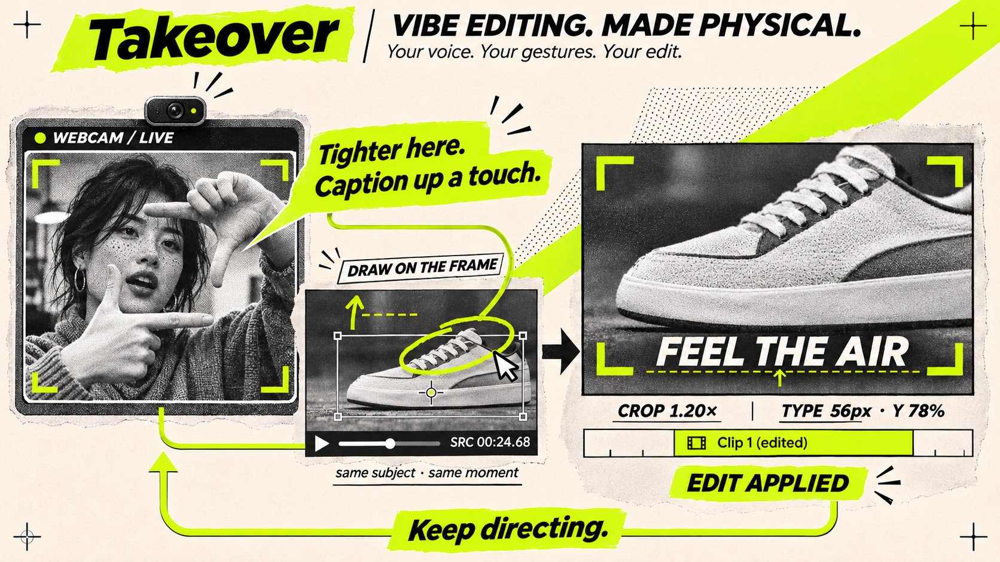
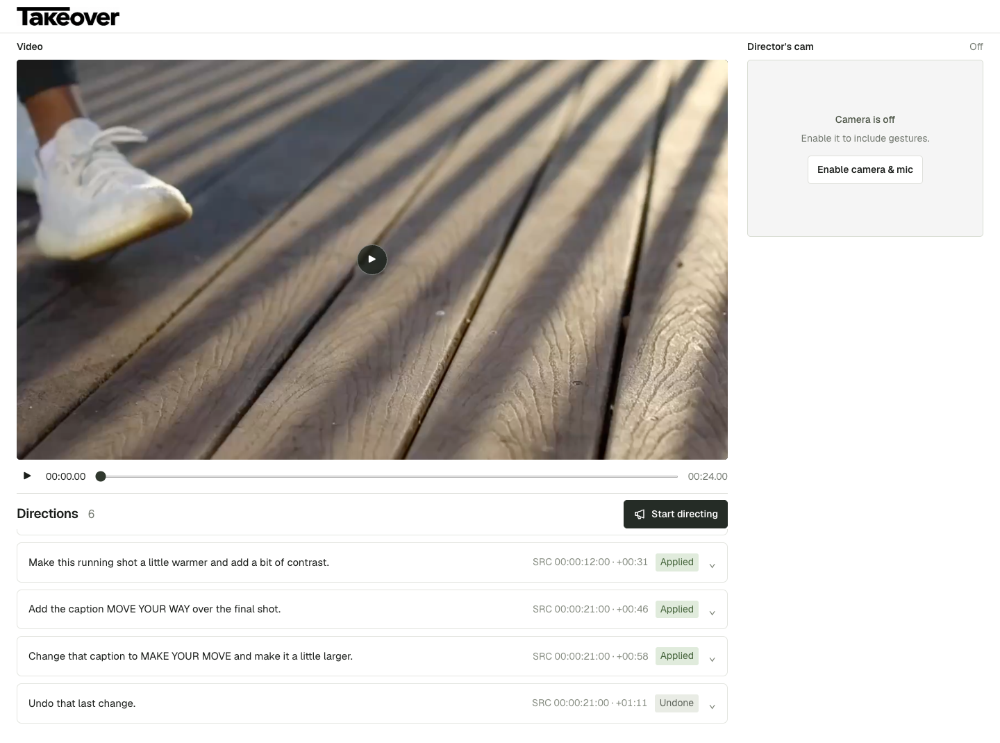

# Vibe editing. Made physical.

**Your voice. Your gestures. Your edit.**

Lean in. Frame the shoe with your hands. **“Zoom in here.”**

See the crop. Lean back. **“Whoa, that is too close. Back off a little.”**

Raise a palm. Lower it slowly. **“Half speed.”**

**Takeover turns the way you direct into the way you edit.** Your words, visible gestures, and pointer meet at the moment on screen. The app interprets the instruction, applies it through Shoty, and brings back the rendered result. Watch, react, refine.

[See the demo](#one-ad-seven-directions) · [Under the hood](#what-does-this-shoe-actually-mean) · [Run locally](#run-locally)

Built for [c0mpiled-18 · YC Startup School Hackathon, Taipei](https://luma.com/compiled-poy7).

## One ad. Seven directions.

Start with the original 30-second **Nike Air Max 2017** advertisement. Keep the original cut and soundtrack. Direct it with your face and both hands in view; use the mouse to identify an exact spot.

| You say | You show | The edit |
| --- | --- | --- |
| “Okay, zoom in on this shoe a little.” | Lean in and frame it with both hands. | Tighten the product shot around the pointed shoe. |
| “Whoa, that is too close. Back off a little.” | Lean back and bring your hands inward. | Reduce the previous zoom. |
| “Hold on. Slow this shot down to half speed.” | Raise an open palm, then lower it slowly. | Slow the water shoe shot to 0.5×. |
| “This feels a little cold. Make it warmer.” | Turn your hand as if adjusting a dial. | Warm that shot's color. |
| “Add FEEL THE AIR as a caption down here.” | Point below the shoe on screen and in the camera. | Place the headline beneath the product. |
| “Make the caption bigger, and move it up a little.” | Spread your hands, then lift one palm. | Revise the same caption's size and position. |
| “Actually, undo that last change.” | Give a small backward wave while saying undo. | Restore the previous caption style. |

The spoken instruction specifies the change; your visible performance reinforces it. Each accepted direction becomes a real edit in Shoty and a new native video export. Wait for **Applied**, watch it, and keep directing. Finish by replaying the edited ad.

**90-second video:** the YouTube walkthrough will be linked here after upload.

<!-- DEMO_VIDEO: Replace the sentence above with a linked thumbnail once the final
YouTube video exists. Use its real video ID. Do not publish a placeholder URL. -->

The [full rehearsal](demo/sneaker-scenario.json) includes exact source moments, spoken lines, pointing instructions, and expected results.

<details>
<summary>See the actual workspace from an earlier sneaker rehearsal</summary>



The illustration at the top explains the concept. This is the working interface: one preview, your camera, and the directions that changed the video.

</details>

## What does “this shoe” actually mean?

That short sentence leaves out the shot, timestamp, subject, crop center, and edit amount. People fill those gaps with shared context. Takeover captures that context.

When speech begins, it records the source time, session time, and pointer position. Recent frames pair the footage with the director's camera and visible strokes. The interpreter receives those together with the current successful edit state.

That gives **“this”** a subject, **“here”** a source moment, and **“a little less”** a previous decision to revise.

Gestures support an explicit spoken instruction. A facial expression or nod alone does not authorize an edit. An unclear request produces a clarification instead of a guessed change.

## One direction, end to end

```text
Chrome
  final speech + speech-start anchor + pointer / strokes + composite frames
       │
       ▼
POST /api/direct
  cue + frames + current successful state
       │
       ▼
Multimodal planner
  Claude API, or authenticated Codex CLI
  → { status, message, evidence, edits }
       │
       ├── clarify / hold → explain; keep the current edit
       ├── undo           → restore the previous successful revision
       │
       ▼ edit
Bounded state reducer → fresh Shoty sequence → native export
       │
       ▼
Commit state + history → replace video preview → next direction
```

The model interprets intent. Application code owns the edit vocabulary, numeric bounds, shot identities, and execution. Shoty owns the timeline changes and rendering.

## Two clocks, one intended moment

The source playhead and the directing session run on different clocks. Pausing, seeking, trimming, or slowing a shot makes that distinction essential.

| Coordinate | Meaning |
| --- | --- |
| `sourceTime` | Position in the original footage when speech begins. |
| `sessionTime` | Elapsed directing time, used to align speech, pointer events, and captured context. |
| `explicitTime` | A source timestamp parsed from the spoken instruction, when present. |
| Output time | Position in the edited sequence after speed and trim changes. |

For a source point `t` inside shot `k`, output placement follows:

```text
output(t) = Σ duration(j) + clamp(t − sourceStart(k), 0, retainedLength(k)) / speed(k)
            j < k

duration(j) = round(retainedLength(j) / speed(j) × fps) / fps
```

Caption intervals live in source coordinates. Each interval is intersected with the retained portion of every shot, mapped through its speed, and quantized to output frames. A caption spanning multiple shots becomes multiple correctly placed render segments.

Pointer coordinates are normalized inside the actual video image, accounting for letterboxing. When pointing at an edited crop, the browser maps the point back into source coordinates before passing it to the interpreter.

## A small language of real edits

The planner returns one of four outcomes: `edit`, `clarify`, `hold`, or `undo`. An edit contains up to eight operations. A zoom operation, for example, carries:

```json
{
  "action": "zoom",
  "shotId": "hero",
  "value": 1.2,
  "target": { "x": 0.51, "y": 0.52 }
}
```

The schema also carries caption and interval fields; the example shows the fields relevant to zoom. The reducer validates operations against the existing shots and applies absolute settings to a cloned state.

| Operation | Bounds / behavior |
| --- | --- |
| Zoom | 1–1.8×, with a normalized source target. |
| Exposure | −1.5 to +1.5 EV. |
| Contrast / saturation | 0.5–1.6 / 0–1.8; neutral is 1. |
| Temperature | −2000 to +2000 creative units. |
| Speed | 0.5–2×; subsequent clips are placed using the new duration. |
| Trim | Shorten a shot's tail; retain at least 0.2 seconds. |
| Caption | Exact authored text, source interval, size, and position; revisions use the existing caption ID. |
| Reset / undo | Reset the selected shot, or restore the previous successful revision. |

Claude uses streamed, schema-constrained responses through the Anthropic SDK. The alternative Codex adapter runs an ephemeral, read-only CLI invocation with a JSON output schema. Both feed the same validation and execution path.

## Rendering is the commit boundary

Each edit renders into a **fresh Shoty sequence**. Clip transforms, color grades, linked audio speed, and caption graphics are applied through explicit CLI calls. The previous successful sequence remains available while export runs.

Only a completed, non-empty native export advances the server's state and undo history. On failure, the preview retains the last successful result and the engine attempts to reopen its sequence. Voice undo restores a previous sequence and immutable export without asking the model to recreate the edit.

The browser queues directions. The server additionally rejects concurrent edit requests with `409`. Each direction records its progression through interpretation, editing, rendering, and completion or failure.

**Start directing** also starts a composite recording of footage, pointer, webcam, transcript, and director microphone audio. **Stop directing** waits for queued work, then saves the recording and a JSON session manifest. This session recording and the native edited video are separate outputs.

## Run locally

You need **Node.js 22+**, desktop **Chrome**, and a working **Shoty CLI with an active local project session**. For interpretation, provide `CLAUDE_DZ_DEV_API_KEY` through the process environment, or authenticate the `codex` CLI. The app uses Claude when the key is present and Codex otherwise.

```sh
npm ci
mkdir -p media .runtime
```

Place the original 30-second, 1280 × 720, 25 fps demo at `media/nike-air-max-2017.mp4`. The [source archive](https://www.dandad.org/work/d-ad-awards-archive/nike-air-max-2017) is credited below. Create `.runtime/shoty.json` with your active Shoty session:

```json
{
  "sessionId": "YOUR_ACTIVE_SHOTY_SESSION_ID"
}
```

Then import the source and initialize the local demo:

```sh
node scripts/setup-nike-demo.mjs
npm start
```

Open **http://127.0.0.1:4310**. Click **Start directing**, allow camera and microphone access, pause on a subject, and speak. Point or draw on the preview for context. **Space** plays or pauses. Stop directing to save the session under `.runtime/sessions/`; native exports are written to `media/`.

Source regions are configured in [src/footage.mjs](src/footage.mjs). Change that file and the imported source to direct different footage. `PORT` changes the local port; `TAKEOVER_CLAUDE_MODEL` and `TAKEOVER_MODEL` override the respective planner's model. The server does not automatically load `.env` files.

## Code and verification

| Module | Responsibility |
| --- | --- |
| [public/app.mjs](public/app.mjs) | Speech, camera, pointer/strokes, direction queue, and composite recording. |
| [src/capture.mjs](src/capture.mjs) | Speech-start anchors, recent frames, strokes, and explicit timecodes. |
| [src/anthropic-planner.mjs](src/anthropic-planner.mjs) · [src/planner.mjs](src/planner.mjs) | Claude and Codex interpretation adapters. |
| [src/director.mjs](src/director.mjs) | Shot state, bounded reducer, follow-ups, and time/coordinate mapping. |
| [src/captions.mjs](src/captions.mjs) | Source-to-output caption segmentation and escaped graphic content. |
| [src/shoty.mjs](src/shoty.mjs) | Native timeline construction, export, and sequence restoration. |
| [src/server.mjs](src/server.mjs) | Local API, serialization, persistence, and recording storage. |

```sh
npm test
```

The suite covers source timing, coordinate mapping, edit validation, captions, cue capture, API serialization, rollback, undo, and interface contracts. After preparing the local source, `npm run test:browser` exercises the browser with simulated speech and camera input and real MediaRecorder capture. Native rendering and live speech require the configured desktop dependencies.

## What's here, and what powers it

This repository contains Takeover's directing workspace, synchronized cue capture, interpretation adapters, edit validation, native editing orchestration, and session recording. **Shoty is a pre-existing video editor and rendering engine.** The model APIs, Codex CLI, browser speech recognition, fonts, and demonstration footage are also existing dependencies.

This is a local prototype with configured shot regions and serialized rendering. Object tracking, masks, freeze frames, and generated replacement scenes are outside the current editing vocabulary. Inference sends transcripts and selected context frames to the configured model; browser speech recognition may also use a remote service. Media, recordings, and runtime state stay out of Git.

## Credits

- Current demo: **Nike Air Max 2017 — Go Lighter, Go Longer**, Nike Europe / ManvsMachine / Zelig Sound, via the [D&AD archive](https://www.dandad.org/work/d-ad-awards-archive/nike-air-max-2017). Original footage and soundtrack are used for an independent editing demonstration; Takeover is not affiliated with Nike.
- Earlier rehearsal: [Ketut Subiyanto](https://www.pexels.com/video/a-woman-tying-her-shoes-4922551/) and [KoolShooters](https://www.pexels.com/video/close-up-of-a-person-running-8520623/) / Pexels.
- Typography: Geist, with its [font license](public/fonts/OFL.txt).
- Concept illustration: generated with ImageGen; [generation prompt](docs/assets/takeover-concept-v3-prompt.txt).
